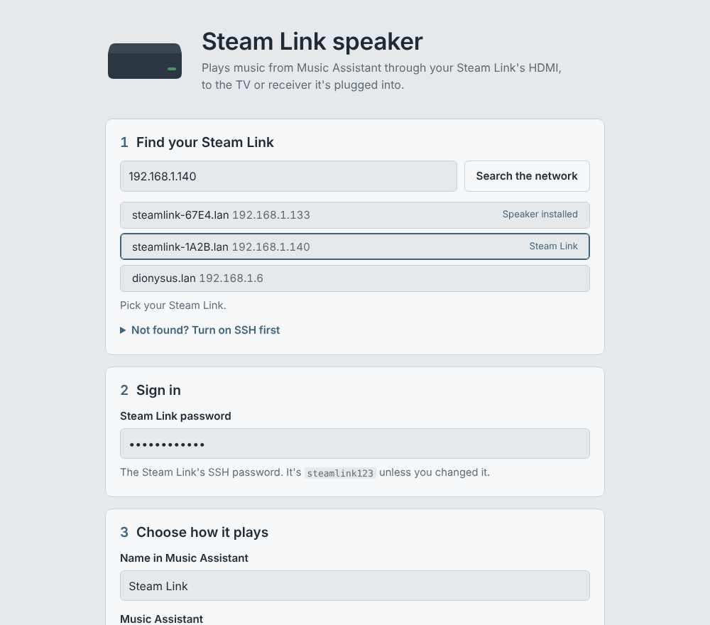

# Steam Link Speaker

Turn an original Valve Steam Link into a [Music Assistant](https://music-assistant.io) speaker.
It plays synchronized audio over HDMI to whatever the Steam Link is plugged into: a TV, a
soundbar or an AV receiver.

The Steam Link keeps its stock firmware. Nothing is flashed: the installer adds a small
[Sendspin](https://www.sendspin-audio.com/) player and one startup file, and can remove both
again.



## What you need

- An original Valve Steam Link (the small black box, model 1001) on the stock firmware.
- Music Assistant **2.10.x** with its Sendspin provider. Keep "Allow legacy clients" on (the
  default); see [Music Assistant versions](#music-assistant-versions).
- SSH turned on for the Steam Link:
  1. On a FAT32 USB stick, create the folders `steamlink\config\system`.
  2. In that folder, create an empty file named `enable_ssh.txt`.
  3. Plug the stick into the Steam Link and unplug its power for a moment to restart it.

  The SSH password is `steamlink123` unless you've changed it.
- A Windows or Linux computer on the same network.

## Install

Download from the [latest release](../../releases/latest).

### Windows

Run `SteamLinkSpeaker.exe`. A page opens in your browser:

1. **Find your Steam Link.** It searches your network and lists Steam Links first.
2. **Sign in** with the Steam Link's SSH password.
3. **Choose how it plays**: the name to show in Music Assistant, and Music Assistant's address.
   It's filled in automatically when Music Assistant is found on the network.

Then select **Install on Steam Link**. The player appears in Music Assistant within a few seconds.

The app isn't code-signed, so Windows shows "Windows protected your PC" the first time. Select
**More info**, then **Run anyway**. The app only serves its page to your own computer and quits
when you close the tab.

### Linux

Run the script and answer its questions:

```sh
bash steamlink-sendspin.sh
```

Or give everything at once, for example from the Music Assistant server:

```sh
NAME="Living Room" bash steamlink-sendspin.sh install 192.168.1.133
```

Prefer the browser app? `steamlink-speaker-linux-x64` (or `-arm64`, for a Raspberry Pi) is the
same app as the Windows one.

## After installing

At boot the Steam Link starts as usual, shows its interface for about half a minute, and then
the speaker takes over. The TV keeps showing the last frame; that's expected.

From the app's **Manage** section, or with the script:

| Action | App button | Script command |
| --- | --- | --- |
| See what's installed and running | Check status | `status` |
| Read the player's log | Show player log | `log` |
| Restart the player | Restart player | `restart` |
| Boot the normal Steam Link interface, keep the install | Use as Steam Link again | `ui` |
| Boot as a speaker again | Use as speaker again | `speaker` |
| Remove everything and restore the original startup | Remove from Steam Link | `uninstall` |

Install again at any time to upgrade; your settings are kept.

## Troubleshooting

**No sound.** Check the player log. A healthy boot looks like this:

```
supervisor version 6 starting (boot)
media server up after 0s
Steam Link interface up after 2s; letting it finish starting
stopped the Steam Link interface
starting sendspin-steamlink
...
>>> server connected
```

The `trace` command (script) shows the supervisor's step-by-step trace if it stops earlier.

**This speaker is out of sync with the others.** Set the player's delay in Music Assistant, or
`LATENCY_MS` in `/mnt/scratch/sendspin/sendspin.conf` on the Steam Link, then restart the player.

**Back to normal, whatever state it's in.** Use **Remove from Steam Link** (or `uninstall`). As
a last resort, the Steam Link's own factory reset works too: an empty `factory_reset.txt` in a
`steamlink` folder on a USB stick, then restart it.

**Security.** SSH stays on with the password it had. To change it, sign in with
`ssh root@<steamlink-address>` and run `passwd`; then use the new password in the installer.

## Music Assistant versions

Music Assistant 2.10.x speaks a Sendspin protocol version from before encryption was finalized.
This release is built for it and connects as a "legacy" (unencrypted) player, which 2.10.x
accepts while "Allow legacy clients" is on.

Later Music Assistant versions move to the encrypted Sendspin 1.0 protocol and will eventually
drop legacy players. `./build.sh encrypted` builds the player for those; it completes the
encrypted handshake with the newer server library but hasn't been tested end to end yet.

## How it works

- **The player** (`src/`) is built on [sendspin-cpp](https://github.com/Sendspin/sendspin-cpp)
  v0.8.0. It plays through the firmware's own SDL2 library and its `marvell` audio driver, loaded
  at runtime, so it needs nothing beyond what the Steam Link already has. It's cross-compiled
  with zig for the Steam Link's ARMv7 CPU and glibc 2.19 (Valve's SDK compiler is too old for
  C++20), linked with `-z lazy` because the firmware's loader crashes on bind-now executables.
- **Startup** (`device/S99steam`): the firmware mounts `/etc` as an overlay on its config
  partition, so the installer replaces one startup script there and backs up the original.
  The original startup always runs first, because it loads the Marvell drivers and starts the
  `PE_Single_CPU` media server that HDMI audio depends on.
- **The supervisor** (`device/run.sh`) waits for the media server and the Steam Link
  interface, pauses the power manager and the interface's relaunch script, closes the
  interface, and runs the player. It restarts the player if it exits, and takes over again if
  the interface comes back.
- **On the Steam Link**, everything lives in `/mnt/scratch/sendspin` plus the startup script in
  `/mnt/config/overlay/etc/init.d/startup/S99steam`.
- **The installers** (`app/`, `host/`) carry the player inside them, send it over SSH and run
  `device/ctl.sh` on the Steam Link.

## Building from source

On Linux, with cmake, git, Go 1.24+ and Python 3:

```sh
pip install ziglang
./build.sh            # Music Assistant 2.10.x (legacy protocol)
./build.sh encrypted  # Sendspin 1.0 servers
```

Everything lands in `dist/`. Releases are built the same way by GitHub Actions
(`.github/workflows/build.yml`) whenever a `v*` tag is pushed.

## Status

Tested on an original Steam Link with its final firmware and Music Assistant 2.10.6. Reports
from other units, firmware versions and setups are welcome: please open an issue with the
output of the `status` and `log` commands.

## License

Apache License 2.0, see [LICENSE](LICENSE).

The player and the installer apps include third-party code under its own licenses, among them
sendspin-cpp, micro-flac and micro-opus (Apache 2.0), Opus, IXWebSocket and Go's libraries
(BSD 3-Clause), and ArduinoJson (MIT). See [THIRD_PARTY_NOTICES.md](THIRD_PARTY_NOTICES.md).

Not affiliated with Valve, the Open Home Foundation or Music Assistant. Steam Link is a
trademark of Valve Corporation.
